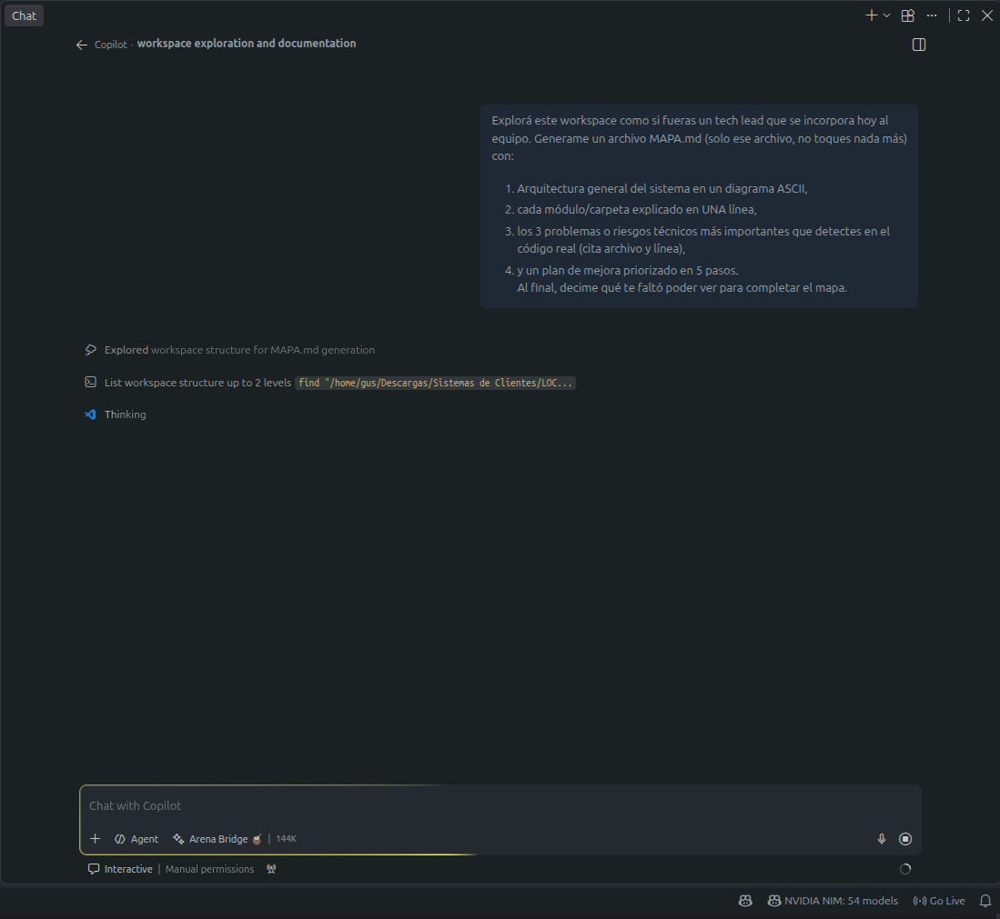

# 🌉 Arena Bridge


**Your own OpenAI-compatible LLM gateway, running on your machine — point GitHub Copilot (BYOK), Roo Code, Cline or any OpenAI-compatible client at `localhost:4010/v1` and route to *any* backend: NVIDIA NIM, Ollama, OpenRouter, Groq, Gemini… and the upcoming Arena API.**

Multi-backend routing 🧠 · automatic failover 🛟 · secrets via env expansion 🔐 · `.deb` installer with **automatic VS Code model registration** 🎛️ · usage log 📊 · **zero dependencies** (plain Node 18+)



---

## English (quickstart)

```bash
# 1. Install the .deb from Releases
sudo dpkg -i arena-bridge_*_all.deb

# 2. Add your keys (NIM / OpenRouter / Groq...)
arena-bridge --setup          # exports like NIM_API_KEY=nvapi-...

# 3. Declare your brains and auto-register them in VS Code
arena-bridge --setup-backends # edit backends.json → auto-syncs the model picker

# 4. (Optional) run as a user service
systemctl --user enable --now arena-bridge
```

Then reload VS Code and pick e.g. **Arena Bridge 🧠** in the Copilot Chat model selector.
No Debian? Clone and run `node server.js` — works out of the box in mock mode.

**Disclaimer**: community project, *not affiliated with Arena.ai, GitHub or NVIDIA*. "Arena Bridge" is a nod to Arena's Agent Mode and VS Code's Bring-Your-Own-Key, which inspired this tool.

📖 **Documentación completa en español abajo** ⬇️

---

## 🇪🇸 Documentación completa

### ¿Qué es?

Un **gateway local OpenAI-compatible que corre 100% en tu máquina**. Apuntás tu editor a **TU** API en `localhost:4010` y el bridge rutea cada pedido al cerebro que elijas: modelos gratis de NVIDIA NIM, tu Ollama local, OpenRouter, Groq, Gemini, o la futura API pública de Arena.

```
VS Code (Copilot BYOK / Roo Code) ──▶ Arena Bridge :4010 ──▶ tus cerebros
                                             │
                                             ├─▶ 🧠 arena-bridge/fast  → NIM  glm-5.3-flash
                                             ├─▶ 🧠 arena-bridge/pro   → NIM  kimi-k2.6
                                             ├─▶ 🏠 arena-bridge/local → Ollama qwen2.5-coder
                                             └─▶ 🛟 si uno falla (429/5xx/red) → failover al siguiente
```

### ✨ Features

| Feature | Detalle |
|---|---|
| 🧠 Multi-cerebro | Declarás N backends en `backends.json`; cada uno aparece como modelo propio en el picker de VS Code |
| 🛟 Failover | Rate-limit / 5xx / sin red → intenta el siguiente cerebro automáticamente |
| 🎛️ Registro en VS Code | El instalador (o `--install-vscode`) escribe `chatLanguageModels.json` sin tocar tus otros providers — y lo limpia al desinstalar |
| 🔐 Secretos seguros | Keys SOLO en `~/.config/arena-bridge/.env` (permisos 600); `backends.json` usa `"${VAR}"` |
| 📊 Usage log | Cada request a `~/.config/arena-bridge/usage.jsonl` (cerebro, modelo, ms, status) |
| 🧉 Modo mock | Sin config, responde de prueba para validar el cableado |
| 🪶 Cero dependencias | Node 18+ pelado. Sin npm install, sin sorpresas |

### 🚀 Instalación (.deb, recomendada)

```bash
sudo dpkg -i arena-bridge_0.4.0_all.deb   # Registra el modelo en VS Code automáticamente ✨
arena-bridge --setup          # 🔑 keys: NIM_API_KEY=..., etc.
arena-bridge --setup-backends # 🧠 ejército de cerebros + sync con VS Code
systemctl --user enable --now arena-bridge   # opcional: servicio permanente
```

Al terminar: VS Code → `Ctrl+Shift+P` → **Developer: Reload Window** → model picker → tu cerebro 🧉

### ▶️ Sin instalar (modo dev)

```bash
git clone https://github.com/gustavosergiogonzalez/arena-bridge.git
cd arena-bridge
node server.js      # arranca en MOCK; probá: curl localhost:4010/health
```

Config por usuario en `~/.config/arena-bridge/` (`.env` + `backends.json`), o junto al script en modo dev.

### ⚙️ Configuración

**`.env`** — variables base y secretos (ver `.env.example`):

| Var | Default | Qué hace |
|---|---|---|
| `PORT` | `4010` | Puerto del gateway |
| `BRIDGE_KEY` | — | Si la ponés, exige `Authorization: Bearer` a los clientes |
| `NIM_API_KEY` / `OPENROUTER_API_KEY` / … | — | Inyectadas en `backends.json` vía `${VAR}` |
| `BACKEND_BASE_URL`/`BACKEND_API_KEY`/`BACKEND_MODEL` | — | Modo legacy de 1 cerebro (el multi lo pisa si hay backends.json) |

**`backends.json`** — tu ejército (ver `backends.json.example`):

```json
{
  "failover": true,
  "backends": [
    {"id": "fast",  "name": "Arena Bridge ⚡", "base_url": "https://integrate.api.nvidia.com/v1",
     "api_key": "${NIM_API_KEY}", "model": "z-ai/glm-5.3-flash", "max_input_tokens": 131000},
    {"id": "local", "name": "Arena Bridge 🏠", "base_url": "http://127.0.0.1:11434/v1",
     "api_key": "ollama", "model": "qwen2.5-coder:7b"}
  ]
}
```

- `id` → el modelo en el picker: `arena-bridge/<id>`
- `arena-bridge/auto` → siempre el primero de la lista (failover al resto si cae)
- Campos por cerebro: `tool_calling`, `vision`, `max_input_tokens`, `max_output_tokens`

### 🧰 Comandos

```text
arena-bridge                 levanta el bridge (foreground)
arena-bridge --status        estado, modo y cerebros
arena-bridge --setup         edita .env (keys)
arena-bridge --setup-backends edita backends.json + re-registra VS Code
arena-bridge --install-vscode / --remove-vscode
```

### 👨‍💻 Desarrollo y empaquetado

```bash
node server.js                 # dev
./build-deb.sh                 # genera dist/arena-bridge_<ver>_all.deb
```

Servicio systemd de ejemplo en `systemd/arena-bridge.service`.

### 🗺️ Roadmap

- [ ] Extensión VS Code nativa (Language Model Chat Provider API) — modelos directo en el picker
- [ ] Routing por tipo de tarea (heurísticas: largo del prompt, tools, archivos)
- [ ] Dashboard web de uso
- [ ] Soporte de la futura API pública de Arena (waitlist)
- [ ] Streaming con métricas de tokens por cerebro

### 🤝 Contribuir

Issues y PRs bienvenidos. El código es un único `server.js` sin dependencias: el aporte tiene que mantener esa propiedad 😄

### 👤 Autor

**Gustavo Gonzalez** — [github.com/gustavosergiogonzalez/arena-bridge](https://github.com/gustavosergiogonzalez/arena-bridge)
Construido con ayuda del Agent Mode de Arena.ai (un chat que programó a otro chat que programa chats 🪄)

### 📜 Licencia

MIT — usalo, modificalo, compartilo. Sin garantía.
